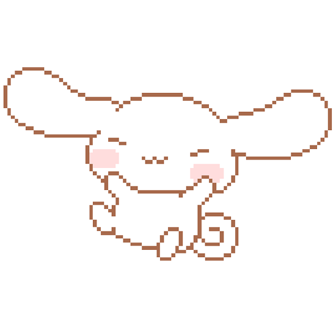

 

 

## 👻 A little about me...

  

I'm a **Software Engineer focused on AI systems**. I build the engineering around models that turns them into products: LLM-powered services, retrieval pipelines, agent tooling, and the evaluation and observability that keep them reliable in production. I care about systems that are fast, measurable and easy to operate.

- 🧠 **Interested in:** LLM inference & serving, agents / tool use, evals, retrieval, MLOps
- 📊 **Also into:** data science & ML experiments — find me on [Kaggle](https://www.kaggle.com/jasmine20006778)
- 💬 **Ask me about:** Python, backend architecture, shipping ML to production
- 🤝 **Let's connect:** [LinkedIn](https://www.linkedin.com/in/jasmine-christopher/) · [Portfolio](https://portfolio-nu-one-95.vercel.app/)

### 🛠️ Tech stack

  

##  GitHub Stats:

  
  

  
  
  

<!-- LeetCode heatmap: replace YOUR_LEETCODE_USERNAME and remove the comment markers to show it

-->

  

<picture>
  <source media="(prefers-color-scheme: dark)" srcset="assets/snake.svg" />
  <source media="(prefers-color-scheme: light)" srcset="assets/snake-light.svg" />
  
</picture>

<!-- 3D chart: pink custom in dark mode, "season" preset in light mode.
     Other designs you can swap in (same folder): profile-night-rainbow.svg, profile-night-view.svg,
     profile-night-green.svg, profile-season-animate.svg, profile-green-animate.svg, profile-gitblock.svg -->
<picture>
  <source media="(prefers-color-scheme: dark)" srcset="profile-3d-contrib/profile-pink.svg" />
  <source media="(prefers-color-scheme: light)" srcset="profile-3d-contrib/profile-season.svg" />
  
</picture>

<h3>📌 Pinned</h3>

 

<!-- PINNED:START -->
Generated by the workflow on first run.
<!-- PINNED:END -->

  
    
  

